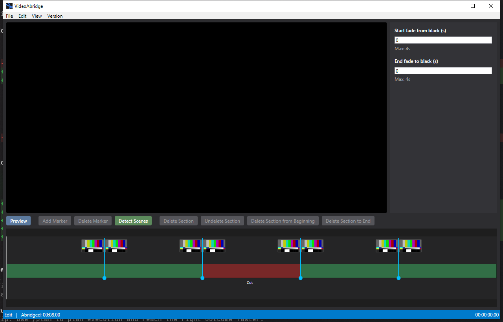

# VideoAbridge



**Mission:** make it easy to produce short versions of a **single, already edited** video.

VideoAbridge is not a general NLE and not a multi-clip editor. You open one finished cut, mark what to drop, and export a tighter cut—with optional alternate abridgements of the same source—without rebuilding the timeline from scratch.

## Features

### Editing the abridgement
- **Markers** — place user markers at the playhead; select one or more to define section boundaries
- **Delete / undelete sections** — remove the range between selected markers, or restore it; also delete from the start or through the end of the video
- **Scene detection** — FFmpeg-based scene cuts become shared scene markers (protected from casual delete); detection resumes when you reopen a file
- **Per-join transitions** — each interior deletion is a hard cut or a crossfade; crossfade length is capped by the adjacent kept segments
- **Start / end fades** — optional fade from black and fade to black on the abridged output
- **Undo / redo** — full edit history for the active version (Ctrl+Z / Ctrl+Y)

### Versions
- **Multiple abridged versions** of the same source video (tabs when more than one exists)
- **New version from scenes** — start a version that keeps only shared scene-detect markers
- **Duplicate / rename / delete** versions; scene markers stay shared across versions

### Preview & playback
- **LibVLC** playback of the source file with playhead sync to the timeline
- **Edit vs Preview mode** — Edit shows the full source with deleted ranges; Preview shows the abridged timeline (kept sections only) with blackout / crossfade visuals approximating the export
- Marker **thumbnails** along the timeline

### Timeline navigation
- Click timeline to seek; Ctrl+Wheel to zoom
- **Zoom to Content** — fit all undeleted sections in view
- **Zoom to Fit** — full zoom out over the whole displayed timeline

### Persistence & export
- **Automatic cache** of versions, markers, cuts, joins, and fades keyed by file content fingerprint (reopen the same file → restore work)
- **Export** — FFmpeg writes an abridged MP4 (kept clips + joins + fades)
- **Tasks pane** — progress for long jobs (scene detect, export), with cancel / open-result actions

## Requirements

- .NET 11 SDK
- FFmpeg and ffprobe on `PATH` (or place `ffmpeg.exe` / `ffprobe.exe` under `tools/ffmpeg/` and copy them next to the app output)
- Windows (LibVLC via `VideoLAN.LibVLC.Windows`)

## Build & run

```bash
dotnet build VideoAbridge.slnx
dotnet run --project src/VideoAbridge/VideoAbridge.csproj
```

```bash
dotnet test VideoAbridge.slnx
dotnet test tests/VideoAbridge.Tests/VideoAbridge.Tests.csproj
dotnet test tests/VideoAbridge.FFmpeg.Tests/VideoAbridge.FFmpeg.Tests.csproj
```

## README screenshot

The hero image is captured automatically on **Windows** before `git push` (markers + one deleted section on a generated sample clip).

```powershell
pwsh tools/install-hooks.ps1          # once per clone: core.hooksPath=.githooks
pwsh tools/capture-readme-screenshot.ps1   # manual refresh
```

If the PNG changes, the pre-push hook asks you to commit it and push again. Skip with `SKIP_README_SCREENSHOT=1 git push`.

## Releases

Pushes to `main` run [.github/workflows/release.yml](.github/workflows/release.yml): tests, publishes a self-contained `win-x64` build, and creates a GitHub Release (`v<year>.<month>.<run_number>`) with a zip asset. Put `[skip release]` in the commit message to skip. FFmpeg/ffprobe are not bundled—install them separately (see Requirements).

## Typical workflow

1. **File → Open Video** — probes duration, restores cached versions/edits if present, resumes scene detection when needed.
2. Add markers (manually and/or **Detect Scenes**), select boundaries, **Delete Section** (or from beginning / to end).
3. Click a **Cut** / **XF** under a deleted interior run to set hard cut vs crossfade; set start/end fades in the side panel (`0` = off).
4. Toggle **Preview** to scrub the abridged result; use **View → Zoom to Content / Zoom to Fit** as needed.
5. Optionally create more versions (**Version** menu) for alternate short cuts of the same file.
6. **File → Export…** writes the active version’s abridged MP4.

## Solution layout

- `VideoAbridge.Core` — immutable timeline / versions / preview / export-plan domain (`Result<T>` monad)
- `VideoAbridge.FFmpeg` — probe, scene detect, marker thumbnails, export
- `VideoAbridge` — WPF UI, LibVLC playback, project/marker cache
- `VideoAbridge.Core.Tests` / `VideoAbridge.Tests` / `VideoAbridge.FFmpeg.Tests` — unit tests
